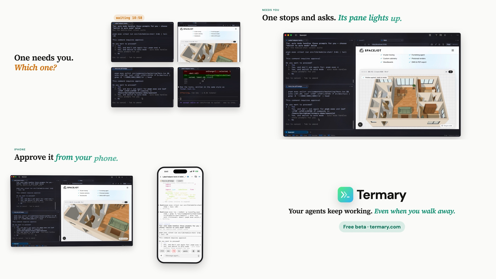
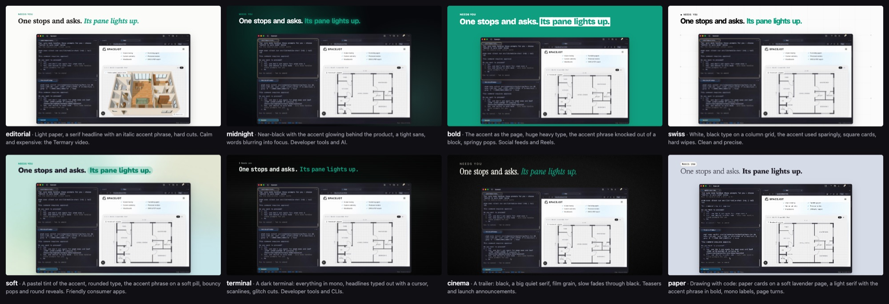
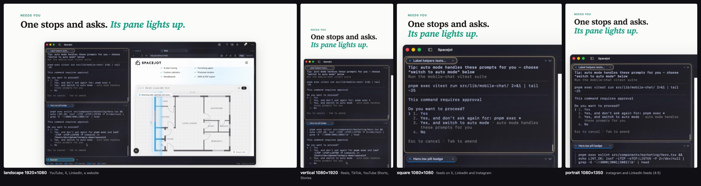
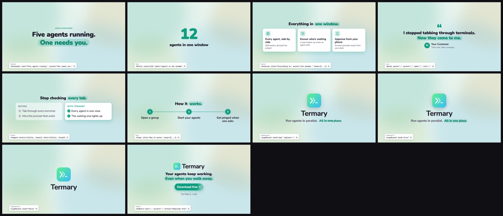
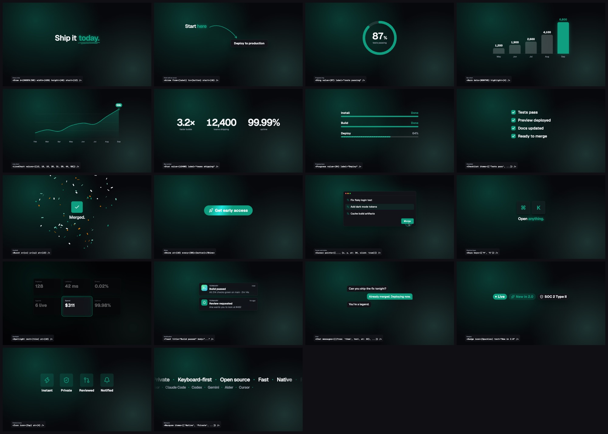
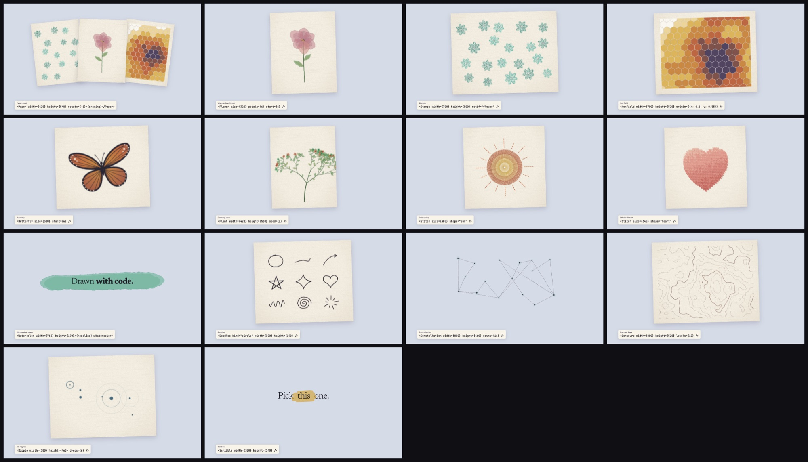
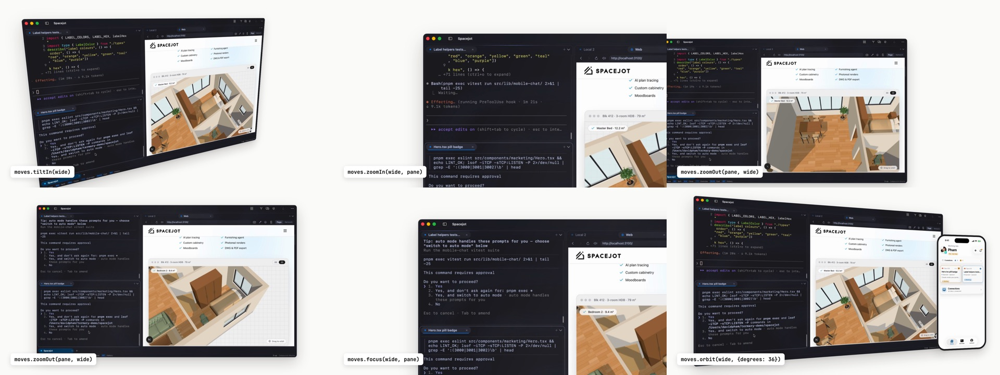

# dolly

**Ask your coding agent for a launch video. It records your app, edits it in 3D, and renders it in
your style for every platform.**

dolly is an agent skill for product videos and motion graphics, written as code in
[Remotion](https://www.remotion.dev). It films your real app and cuts its windows and panes into
3D shots with camera moves, or builds the whole video from motion-graphics templates when there's
nothing to film. It sets headlines in kinetic type, joins scenes with transitions, adds sound, and
checks its own frames before you see anything.

The starter is a 41-second cut of [Termary](https://termary.com)'s launch video:



## Eight styles

The same scenes, restyled by one line in `brand.ts`. A style takes your brand colour and decides
the page, the type, how the accent phrase is set, the backdrop, how words come in and how scenes
change: editorial, midnight, bold, swiss, soft, terminal, cinema, paper.



## Every format

Each scene lays itself out for the frame it's rendered in, and keeps text clear of the buttons
Reels, TikTok and Shorts put over the video. Wide shots push in to one pane in a tall frame; the
phone comes forward.



| Composition | Size | For |
|---|---|---|
| `Video` | 1920×1080 | YouTube, X, LinkedIn, a website |
| `Vertical` | 1080×1920 | Reels, TikTok, YouTube Shorts, Stories |
| `Square` | 1080×1080 | Feeds on X, LinkedIn and Instagram |
| `Portrait` | 1080×1350 | Instagram and LinkedIn feeds |

## Motion graphics

Templates are whole scenes that take words: a statement, a metric, features, a quote, a before and
after, steps, a logo reveal, an end card. Under them are the effects: kinetic type in nine
entrances with seven ways to mark a phrase, 18 graphics (charts, counters, a cursor, keys,
notifications, chat, confetti, a spotlight), 13 illustrations drawn with code (watercolour
flowers, a butterfly, a growing plant, embroidery, a topographic map), 10 backdrops and 24
transitions. `Promo` is a sample
cut made only of templates. `npm run gallery` renders every effect, labelled with the code that
makes it:







## How a video gets made

1. **Plan.** The agent asks where the video will play (which sets the formats), the one thing
   viewers should remember, and the call to action, and shows you every style to pick from.
2. **Record.** `scripts/take.sh` records your Mac's screen, and the iOS Simulator if it's
   running. With [observee](https://github.com/gettermary/observee) installed, the agent drives
   your app itself while it records. No app to film? It builds from templates.
3. **Build scenes.** Windows and panes are cut out of the takes and placed in 3D under a headline,
   the camera pushes in on what matters, and templates and effects fill in the rest.
4. **Review.** The agent renders contact sheets (many frames on one image, with each platform's
   safe area drawn) and reads them.
5. **Render.** Every format you need, plus a poster frame.

## Install

dolly is a folder with a `SKILL.md`, so any agent that reads Agent Skills can use it. For
Claude Code:

```sh
git clone https://github.com/gettermary/dolly ~/.claude/skills/dolly
```

For the agent to record your app by itself, add observee too. It needs Rust:

```sh
git clone https://github.com/gettermary/observee && cd observee && ./install.sh
```

Then ask:

> Make a 30-second launch video for yourapp.com, for Reels and LinkedIn.

The agent starts every video with `new.sh`, which installs what's missing: Node (with Homebrew),
the project's packages, the sound effects, and the headless Chrome that renders the frames.
Recording needs macOS, and your terminal app needs Screen Recording permission (plus
Accessibility for observee). The editing works anywhere.

## Camera moves

Ready-made moves for any shot: `tiltIn`, `zoomIn`, `zoomOut`, `focus`, `pan`, `orbit` and
`pushThrough`. Each turns two framings into keyframes, and they chain. `npm run moves` renders a
sample reel of every one:



```tsx
const wide = focusOn({rect: whole(PAGE), size: PAGE, video, lens: 1800, ...look.aim});
const card = focusOn({rect: PRICING_CARD, size: PAGE, video, lens: 1800, fill: 0.4, ...look.aim});
const camera = useShot(moves.zoomIn(wide, card), {dolly: 40});
```

## What's inside

| | |
|---|---|
| `SKILL.md` | The pipeline the agent follows, the taste, and the rules of motion |
| `new.sh` | Sets up a new video project with everything installed |
| `starter/` | Two working videos to start from: `Video` (made from takes) and `Promo` (templates only) |
| `starter/src/look.tsx` | The styles and formats, read through `useLook()` |
| `starter/src/kit.tsx` | The 3D kit, in one file: `Stage`, `Layer`, `Screen`, `Clip`, `Footage`, `Floor`, `animate`, `useShot`, `focusOn`, `moves` |
| `starter/src/templates.tsx` | Ready-made scenes |
| `starter/src/fx/` | Kinetic type, graphics, backdrops, transitions |
| `starter/scripts/` | `take.sh` records a take (screen and Simulator at once); `sfx.mjs` generates a chime, a whoosh and a click; `music.mjs` generates an original soundtrack of any length |
| `references/` | `effects.md` lists every effect and template; `recipes.md` has bigger camera moves |

Every scene, style, format and effect is rendered and checked against the versions pinned in
`starter/package.json`. The sounds and music are synthesized by the scripts, so they're free to
use anywhere.

## Without an agent

The starter is a normal Remotion project:

```sh
~/.claude/skills/dolly/new.sh ~/my-video && cd ~/my-video
npx remotion studio                                  # preview and scrub
npm run styles                                       # out/styles.png: a frame in every style
scripts/take.sh start A 30 && scripts/take.sh wait   # record a 30 s take
npm run sheet                                        # out/sheet.png: the whole video on one image
npm run render                                       # out/video.mp4; render:vertical, render:square, render:portrait
npx remotion render Vertical out/v.mp4 --props='{"style":"bold"}'   # another style
npm run promo                                        # out/promo.mp4, the templates-only cut
npm run music -- 45                                  # public/music.wav, 45 s of original music
```

## License

dolly's code and docs are MIT licensed (see [LICENSE](LICENSE)). The example recordings and the
logo in `starter/public/` are Termary's, included so the starter renders a real result: replace
them with your own, and don't reuse them. Fonts are Google Fonts (OFL), loaded when rendering;
icons are [lucide](https://lucide.dev) (ISC).

dolly builds on Remotion, which has its own license: free for individuals and companies of up to 3
people, while larger companies need a [company license](https://www.remotion.pro).

Made by the team behind [Termary](https://termary.com). Contributions are welcome; see
[CONTRIBUTING.md](CONTRIBUTING.md).
