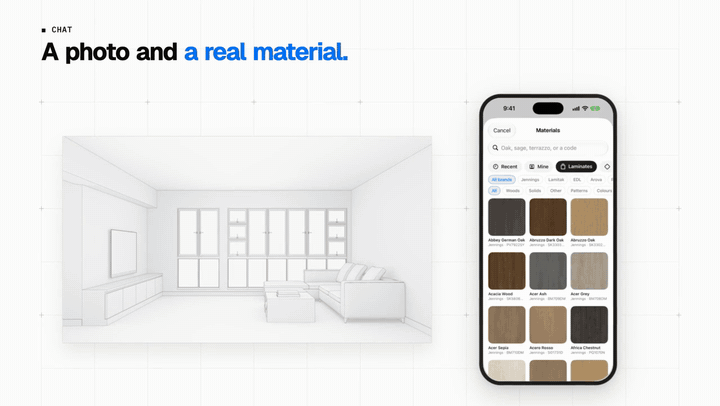
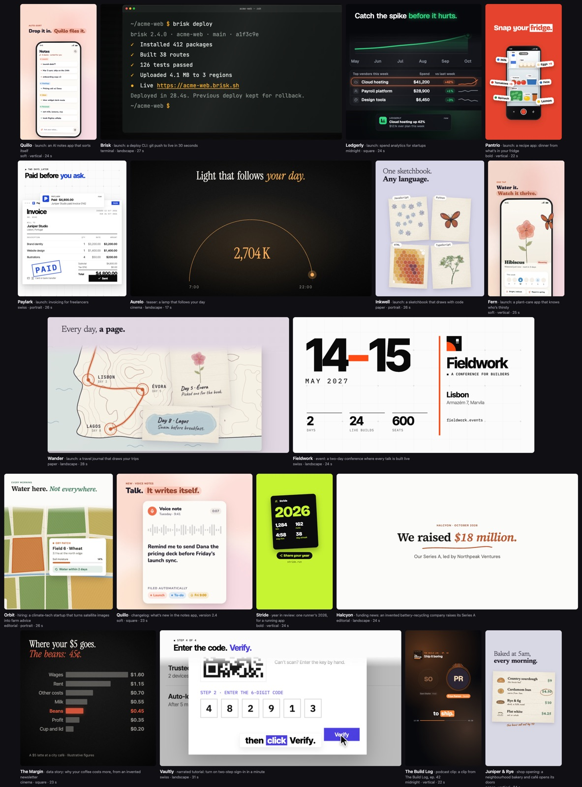

# dolly

**Your coding agent, now a video editor.** Ask for a launch video and it records your real app,
cuts it into 3D shots, sets the words in motion and renders every format, all written as code in
[Remotion](https://www.remotion.dev).



**[▶ Watch the showreel](https://dolly.pvhuwung.com)** · **[Browse the library](https://dolly.pvhuwung.com/library.html)** · 24 videos, 87 components, 8 styles, 4 formats

## Try it

dolly is an Agent Skill: a folder your agent
reads. For Claude Code:

```sh
git clone https://github.com/gettermary/dolly ~/.claude/skills/dolly
```

Then ask:

> Make a 30-second launch video for yourapp.com, for Reels and LinkedIn.

That's it. The agent sets up the project (Node, packages, the renderer), asks only what it can't
work out, and comes back with the files.

**Want it to drive your app by itself?** Add [observee](https://github.com/gettermary/observee), which
lets the agent click and type on your Mac while it records:

```sh
git clone https://github.com/gettermary/observee && cd observee && ./install.sh
```

## How it works

1. **Plan.** It reads your site, asks where the video will play and what viewers should remember,
   and shows you every style to pick from.
2. **Footage.** It records your app (driving it itself on a Mac), writes you a shot list if you'd
   rather record, or **scans recordings you already have** to find the moments worth showing.
3. **Build.** Windows, panes and phones float in 3D under headlines, the camera pushes in on what
   matters, and components from the library fill in the rest.
4. **Review and render.** It can't watch video, so it renders contact sheets and reads them, frame
   by frame, before you see anything. Then every format you need.

## Real footage, not mock-ups

The hero above is from Spacejot's iOS launch. The agent drove the real app in the iOS Simulator,
signed in to the live server, so every room on screen is a real result. When the footage is yours,
`npm run scan` reads it first: where the screen holds still, where it changes, where there's sound,
with a sheet of frames the agent looks at before proposing the video.


## A library of 87 components

Templates (whole scenes), kinetic type, charts and graphics, drawings, voice with captions,
backdrops and transitions. Every one reads your style, fits any format, and starts and leaves on
the frames it's given. The agent picks from a catalog generated from the code, so it never guesses
a prop.

```tsx
<Statement eyebrow="Agents everywhere" text="Five agents running." accent="One needs you." />
<Stat value={12400} label="teams shipping" start={6} />
<Kinetic text="Approve it" accent="from your phone." start={10} exit={80} />
```

**[See every one playing →](https://dolly.pvhuwung.com/library.html)**



## Eight styles, one line

The same video, restyled by one line in `brand.ts`: editorial, midnight, bold, swiss, soft,
terminal, cinema, paper. A style takes your brand colour and decides the page, the type, how words
come in and how scenes change.


## Every format, laid out for it

Each scene lays itself out for the frame it's in and keeps text clear of the buttons Reels, TikTok
and Shorts put over the video. Nothing is cropped from 16:9: wide shots push in, the phone comes
forward.


| Composition | Size | For |
|---|---|---|
| `Video` | 1920×1080 | YouTube, X, LinkedIn, a website |
| `Vertical` | 1080×1920 | Reels, TikTok, YouTube Shorts, Stories |
| `Square` | 1080×1080 | Feeds on X, LinkedIn and Instagram |
| `Portrait` | 1080×1350 | Instagram and LinkedIn feeds |

## Camera moves

`tiltIn`, `zoomIn`, `zoomOut`, `focus`, `pan`, `orbit` and `pushThrough`, each turning two
framings into keyframes:

```tsx
const wide = focusOn({rect: whole(PAGE), size: PAGE, video, lens: 1800, ...look.aim});
const card = focusOn({rect: PRICING_CARD, size: PAGE, video, lens: 1800, fill: 0.4, ...look.aim});
const camera = useShot(moves.zoomIn(wide, card), {dolly: 40});
```


## Without an agent

The starter is a normal Remotion project:

```sh
~/.claude/skills/dolly/new.sh ~/my-video && cd ~/my-video
npx remotion studio                                  # preview and scrub
npm run styles                                       # a frame in every style
scripts/take.sh start A 30 && scripts/take.sh wait   # record a 30 s take
npm run scan                                         # read the recordings in public/takes/
npm run render                                       # out/video.mp4; render:vertical, render:square, render:portrait
npm run gallery                                      # every component, labelled with its code
npm run music -- 45                                  # 45 s of original music
```

Recording works on macOS (your terminal needs Screen Recording permission, plus Accessibility for
observee) and on Windows in Git Bash with ffmpeg. The editing works anywhere.

## What's inside

| | |
|---|---|
| `SKILL.md` | What the agent follows: the pipeline, the taste, the rules of motion, and which guide to read when |
| `references/` | Guides read only when needed: recording on a Mac or elsewhere, your own footage, the camera kit, other kinds of video, the gotchas |
| `starter/` | The project every video starts from: a take-based `Video` and a templates-only `Promo` |
| `starter/src/library/` | The 87 components, one folder each, and [`CATALOG.md`](starter/src/library/CATALOG.md), their index |
| `starter/src/kit.tsx`, `look.tsx` | The 3D kit and camera moves; the styles and formats |
| `starter/scripts/` | Record a take, scan recordings, make sound and music, a voiceover, rebuild the catalog, render the samples |
| `examples/` | The videos made with dolly |

Contributions are welcome: [CONTRIBUTING.md](CONTRIBUTING.md) says how to add a component.

## License

dolly's code and docs are MIT licensed (see [LICENSE](LICENSE)). The example recordings and the
logo in `starter/public/` are Termary's, included so the starter renders a real result: replace
them with your own, and don't reuse them. Fonts are Google Fonts (OFL), loaded when rendering;
icons are [lucide](https://lucide.dev) (ISC).

dolly builds on Remotion, which has its own license: free for individuals and companies of up to 3
people, while larger companies need a [company license](https://www.remotion.pro).

Made by the team behind [Termary](https://termary.com).
