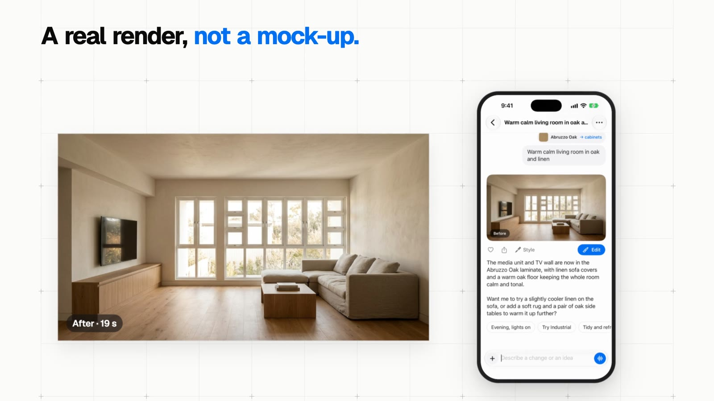

# Examples

Videos made with dolly, and the code that made them. The videos are attached to the
[examples release](https://github.com/pvhuwung/dolly/releases/tag/examples), since they're too big
for the repo.

## Spacejot for iPhone



A launch video for Spacejot's iOS app, an AI interior-design tool. It's made from real takes:
observee drove the app in the iOS Simulator (Xcode 27's Device Hub) while `take.sh` recorded, and
the app was signed in to the live server, so every picture in the video is a real result. A line
drawing and a laminate go into the chat and a render comes back, then reply, edit, explore, plans
and a board for the client. Swiss style, sound effects, no music.

| Video | Format | Length |
|---|---|---|
| [spacejot-16x9.mp4](https://github.com/pvhuwung/dolly/releases/download/examples/spacejot-16x9.mp4) | 16:9, for X, LinkedIn and the site | 57 s |
| [spacejot-9x16.mp4](https://github.com/pvhuwung/dolly/releases/download/examples/spacejot-9x16.mp4) | 9:16, for Reels, TikTok and Shorts | 28 s |

[`spacejot/`](spacejot) holds the files that differ from the starter:

- `src/Video.tsx`: the brief, and both cuts: `SCENES` for 16:9 and `SHORT` for the others.
- `src/scenes/phone.tsx`: the phone playing cuts of a take, with the real picture as a card
  beside it, laid out for wide and tall frames. Every scene is built from it.
- `src/scenes/takes.ts`: where things are in the takes: the phone's size in points, tap points,
  regions.
- `src/scenes/`: `Hook` (a before-and-after wipe), `Restyle` and `Reply`, `Edit`, `More` (explore,
  plans, the client board), `Logo` and `End`.

The takes (300 MB) and the stills of the results aren't in the repo, so this shows how the video
was built but doesn't render as it is.

## 18 mock videos


Invented products and organisations, made to test dolly across every style, format and agenda.
They're built only from templates, effects and drawings, with no recordings. Each is one file in
`src/mocks/`, and `mock.tsx` is the frame they share: brand, style, format, scenes, chimes and
music.

| Video | What | Style | Format | Length |
|---|---|---|---|---|
| [quillo.mp4](https://github.com/pvhuwung/dolly/releases/download/examples/quillo.mp4) | Launch: an AI notes app that sorts itself | soft | vertical | 24 s |
| [brisk.mp4](https://github.com/pvhuwung/dolly/releases/download/examples/brisk.mp4) | Launch: a deploy CLI, git push to live in 30 seconds | terminal | landscape | 27 s |
| [ledgerly.mp4](https://github.com/pvhuwung/dolly/releases/download/examples/ledgerly.mp4) | Launch: spend analytics for startups | midnight | square | 24 s |
| [pantrio.mp4](https://github.com/pvhuwung/dolly/releases/download/examples/pantrio.mp4) | Launch: a recipe app, dinner from what's in your fridge | bold | vertical | 22 s |
| [paylark.mp4](https://github.com/pvhuwung/dolly/releases/download/examples/paylark.mp4) | Launch: invoicing for freelancers | swiss | portrait | 26 s |
| [aurelo.mp4](https://github.com/pvhuwung/dolly/releases/download/examples/aurelo.mp4) | Teaser: a lamp that follows your day | cinema | landscape | 17 s |
| [inkwell.mp4](https://github.com/pvhuwung/dolly/releases/download/examples/inkwell.mp4) | Launch: a sketchbook that draws with code | paper | portrait | 26 s |
| [fern.mp4](https://github.com/pvhuwung/dolly/releases/download/examples/fern.mp4) | Launch: a plant-care app that knows who's thirsty | soft | vertical | 25 s |
| [wander.mp4](https://github.com/pvhuwung/dolly/releases/download/examples/wander.mp4) | Launch: a travel journal that draws your trips | paper | landscape | 28 s |
| [fieldwork.mp4](https://github.com/pvhuwung/dolly/releases/download/examples/fieldwork.mp4) | Event: a two-day conference where every talk is built live | swiss | landscape | 24 s |
| [orbit.mp4](https://github.com/pvhuwung/dolly/releases/download/examples/orbit.mp4) | Hiring: a climate-tech startup that turns satellite images into farm advice | editorial | portrait | 26 s |
| [quillonew.mp4](https://github.com/pvhuwung/dolly/releases/download/examples/quillonew.mp4) | Changelog: what's new in the notes app, version 2.4 | soft | square | 23 s |
| [stride.mp4](https://github.com/pvhuwung/dolly/releases/download/examples/stride.mp4) | Year in review: one runner's 2026, for a running app | bold | vertical | 24 s |
| [halcyon.mp4](https://github.com/pvhuwung/dolly/releases/download/examples/halcyon.mp4) | Funding news: a battery-recycling company raises its Series A | editorial | landscape | 25 s |
| [margin.mp4](https://github.com/pvhuwung/dolly/releases/download/examples/margin.mp4) | Data story: why your coffee costs more, from a newsletter | cinema | square | 23 s |
| [vaultly.mp4](https://github.com/pvhuwung/dolly/releases/download/examples/vaultly.mp4) | Narrated tutorial: turn on two-step sign-in in a minute | swiss | landscape | 31 s |
| [buildlog.mp4](https://github.com/pvhuwung/dolly/releases/download/examples/buildlog.mp4) | Podcast clip: The Build Log, ep. 42 | midnight | vertical | 22 s |
| [juniper.mp4](https://github.com/pvhuwung/dolly/releases/download/examples/juniper.mp4) | Shop opening: a neighbourhood bakery and café opens its doors | paper | vertical | 24 s |

To render them, put [`mocks/`](mocks) over a new project (its `Root.tsx` replaces the starter's):

```sh
~/.claude/skills/dolly/new.sh mocks && cd mocks
cp -R ~/.claude/skills/dolly/examples/mocks/. .
npx remotion still Posters out/posters.png      # every poster frame on one image
npx remotion render Vaultly out/vaultly.mp4      # one mock: its id is its file name
```

Their soundtracks (67 MB) aren't in the repo. Before rendering a mock that has a `music` line,
make its track, with the video's length from the table:
`node scripts/music.mjs public/mocks/quillo-music.wav 24`. Or delete the `music` line. Vaultly and
The Build Log use the voiceovers in `public/voice/`, made with `npm run voice`.

## Termary

[Termary](https://termary.com) runs coding agents in parallel. These videos come from takes of the
app itself; their projects aren't in this repo.

| Video | What | Length |
|---|---|---|
| [termary-demo.mp4](https://github.com/pvhuwung/dolly/releases/download/examples/termary-demo.mp4) | The product demo | 2 min 30 s |
| [termary-demo-voice.mp4](https://github.com/pvhuwung/dolly/releases/download/examples/termary-demo-voice.mp4) | The same, with a voiceover | 2 min 30 s |
| [dolly-starter.mp4](https://github.com/pvhuwung/dolly/releases/download/examples/dolly-starter.mp4) | The starter's `Video`: a cut of the launch video, editorial style | 41 s |

[dolly-showcase.mp4](https://github.com/pvhuwung/dolly/releases/download/examples/dolly-showcase.mp4)
(26 s) is an early reel of dolly itself: placeholder windows and a phone in 3D, on a dark page.
